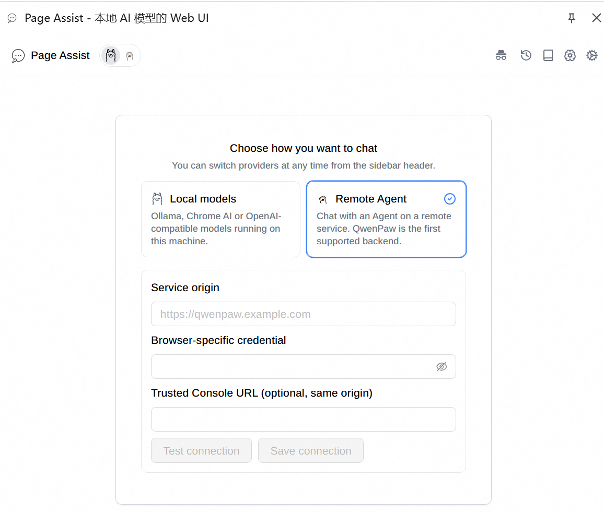
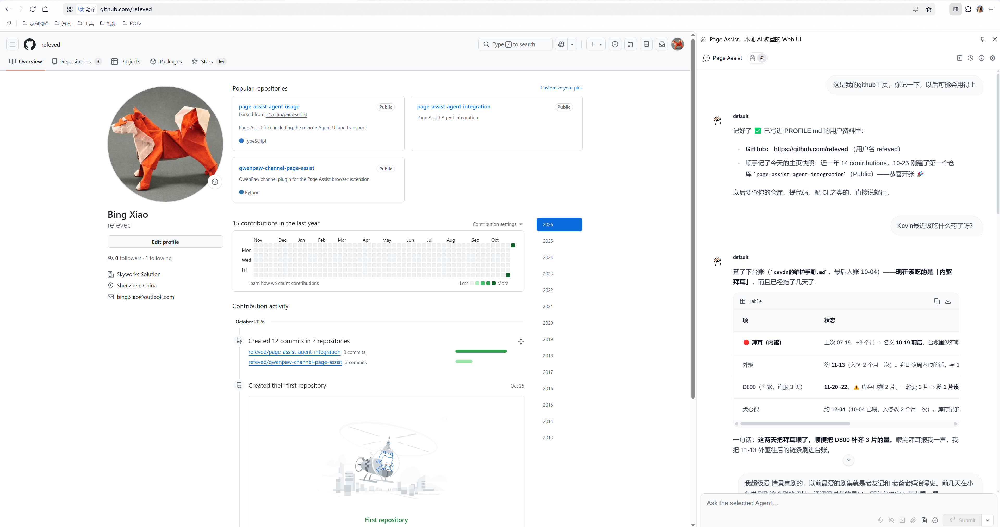

# Page Assist Agent Integration

[简体中文](README.zh-CN.md) | English

This repository coordinates the Page Assist browser extension and Agent host
adapters in one reproducible west workspace. QwenPaw is the first host; the
shared contract stays host-neutral so other OpenClaw-like Agents can be added
through adapters.

## Documentation language policy

Every Markdown document authored in this integration repository must have
Chinese and English versions. Keep the content synchronized and add reciprocal
language links near the top of both files. Use `README.md` /
`README.zh-CN.md` for directory entry pages, and `name.md` /
`name.zh-CN.md` for other documents. Code, identifiers, commands, and protocol
field names remain unchanged across translations.

The workspace contains four independent Git repositories:

| Path | Role |
| --- | --- |
| `integration/` | This repository: west manifest, architecture, shared API contracts, and cross-repository checks |
| `qwenpaw/` | Unmodified upstream QwenPaw source reference; not required to run the plugin |
| [`qwenpaw-channel-page-assist/`](https://github.com/refeved/qwenpaw-channel-page-assist) | Independently installed in-process Page Assist channel plugin |
| `page-assist/` | Page Assist fork, including the Remote Agent provider UI and transport; QwenPaw is the first backend |

The three project checkouts are west projects, **not Git submodules**. `west.yml`
records their source URLs and revisions: QwenPaw tracks the official upstream,
Page Assist tracks the personal fork `refeved/page-assist-agent-usage`, and the
plugin tracks
[refeved/qwenpaw-channel-page-assist](https://github.com/refeved/qwenpaw-channel-page-assist).

## Branches and releases

`main` is the development line. Its `west.yml` follows active development refs:
Page Assist tracks `feat/qwenpaw-remote-channel`, the plugin tracks `main`, and
QwenPaw stays on the released tag `v2.2.2.post1`. `west update` checks those
branches out directly, so commit and push in the project checkout before
updating the manifest.

Cut a version on its own release branch instead of retargeting `main`:

1. Create `release/vX.Y.Z` from the validated `main` commit.
2. On that branch, pin every project in `west.yml` to a release tag or commit
   available from its remote, and list the tags and commit hashes under
   "Release baseline" below.
3. Tag the branch `vX.Y.Z`, then push the branch and the tag.
4. Leave `main` on its development refs.

Branch revisions check out as branches; tag and commit revisions check out as
detached HEAD. Reproduce a released set by checking out its tag here and running
`west update`.

## Release baseline

Tag `v0.1.0` is the first released combination. It predates the release-branch
workflow, so the tag alone identifies it:

- QwenPaw `v2.2.2.post1`, commit `b6715daabaa4f966626317452980fb84b8be9ab9`
- Page Assist fork tag `remote-agent-preview-1`, commit
  `c9eddc0d236bc58944bb0613ec317dd12d548bf1`, based on upstream `v1.5.88`
  (`ad6ef90a9b4b860bbdfc81ee82111c8e04502c65`)
- Plugin tag `remote-agent-preview-1`, commit `093c3b0a521313efa422dda84b1763219a5ced54`

The release set uses tags to identify components; the commit hashes provide
exact verification. Page Assist uses the fork URL so the tagged remote transport
and UI changes are reproducible. Keep every tag and commit available from the
configured remote before sharing or publishing the workspace.

## Remote Agent UI

The browser exposes the remote path as **Remote Agent**, alongside **Local models**.
QwenPaw is the first backend implementation, not the provider name; protocol and
storage identifiers retain the `qwenpaw` namespace. The switch sits in the
side-panel header after the Page Assist wordmark. The standalone Web UI keeps its
existing local send path. When no provider has been chosen and no Ollama URL is
saved, a provider chooser opens the connection form inline; later configuration
lives in the dedicated Remote Agent tab in both the options page and side-panel
settings. No Ollama configuration is required for this path.



On first run the side panel asks how to chat; selecting Remote Agent expands the
connection form inline. The screenshot shows the picker before any connection is
saved.


The side-panel settings bar shows Remote Agent beside General Settings, OpenAI
Compatible API, and Manage Models. The screenshot uses the Chinese UI; component
and protocol names stay in English.

Remote Agent supports text chat, explicit webpage or selection sharing, in-instance
conversation history, and new chats. Local-only features such as RAG, web search,
MCP, prompts, temporary chat, per-chat model settings, file or image upload,
vision/OCR, speech, Page Action, and WebMCP are not available in the remote view.
Firefox does not expose Remote Agent; use a Chromium browser. See the fork's
[Remote Agent guide](https://github.com/refeved/page-assist-agent-usage/blob/feat/qwenpaw-remote-channel/docs/qwenpaw-remote.md)
for current UI and protocol details.

## Runtime

The Page Assist side panel connected to a Remote Agent (QwenPaw backend) and
holding a multi-turn conversation while browsing:



Captured from the v0.1.0 release set while browsing GitHub. Agent names and
conversation content are for demonstration only.

## Initialize

From a clone of this repository:

```bash
west init -l integration
west update
west list
```

The `.west/` directory is created beside `integration/`; the three project
checkouts appear at `qwenpaw/`, `page-assist/`, and
`qwenpaw-channel-page-assist/`.

`west update` also fetches the plugin repository and checks out the manifest
revision.

In this already initialized workspace, update projects after changing `west.yml`
with:

```bash
west update
```

West checks out branch revisions on the branch itself and tag or commit
revisions in detached-HEAD state. Because `main` follows development branches,
commit and push in the product checkout before rerunning `west update`. Do not
use `west update` to manage uncommitted work.

## Development boundaries

- Implement channel behavior only in `qwenpaw-channel-page-assist/`; install it
  into a pip-distributed QwenPaw environment. Do not modify upstream core or add
  a separate relay service between the browser and QwenPaw.
- Implement browser UI, page snapshotting, and remote transport only in
  `page-assist/`.
- Define shared HTTP and SSE behavior in `contracts/` before implementing
  cross-repository changes.
- Put orchestration, cross-repository tests, and release composition here.
- Keep credentials, real user data, and generated artifacts out of Git.

## Local plugin installation and verification

In an existing QwenPaw Python environment:

```bash
python -m pip install qwenpaw==2.2.2.post1
qwenpaw plugin install /path/to/qwenpaw-channel-page-assist
```

For development, install `requirements-dev.txt` from the plugin repository into
a development environment. From the workspace root, verify against the installed
release, without a source-path override:

```bash
env -u PYTHONPATH .venv/bin/python -m pytest -q \
  qwenpaw-channel-page-assist/tests/test_channel.py
cd page-assist
node tests/qwenpaw-channel-browser.mjs
```

The browser regression requires the built extension and the Page Assist test
dependencies. `QWENPAW_TEST_PYTHON` overrides the test interpreter;
`QWENPAW_CHANNEL_DIR` overrides the plugin checkout path.
Changing the checkout does not change the installed plugin copy. Reinstall with
`--force` and restart QwenPaw only when deploying a plugin update.
See the plugin repository's
[README](https://github.com/refeved/qwenpaw-channel-page-assist/blob/main/README.md)
for configuration.

See [docs/architecture.md](docs/architecture.md) for the ownership and
coordination model, and [contracts/README.md](contracts/README.md) for the
contract authoring guidance.

The full product design and implementation plan is available in
[English](docs/design.md) and [Chinese](docs/design.zh-CN.md).
For the first release, the [basic channel profile](contracts/README.md#first-release-basic-channel-profile)
overrides the full design: one Agent per dedicated in-process listener, with
durable recovery and browser approval cards deferred.

Chinese versions: [工作区架构](docs/architecture.zh-CN.md) ·
[共享 API 契约](contracts/README.zh-CN.md).

## License

This repository is licensed under the [Apache License 2.0](LICENSE).

It is an independent community integration and is not affiliated with or
endorsed by the Page Assist or QwenPaw projects. Upstream components keep their
own terms: the Page Assist fork remains MIT, QwenPaw is Apache-2.0, and the
QwenPaw paw icon bundled by the fork retains its Apache-2.0 notice.
